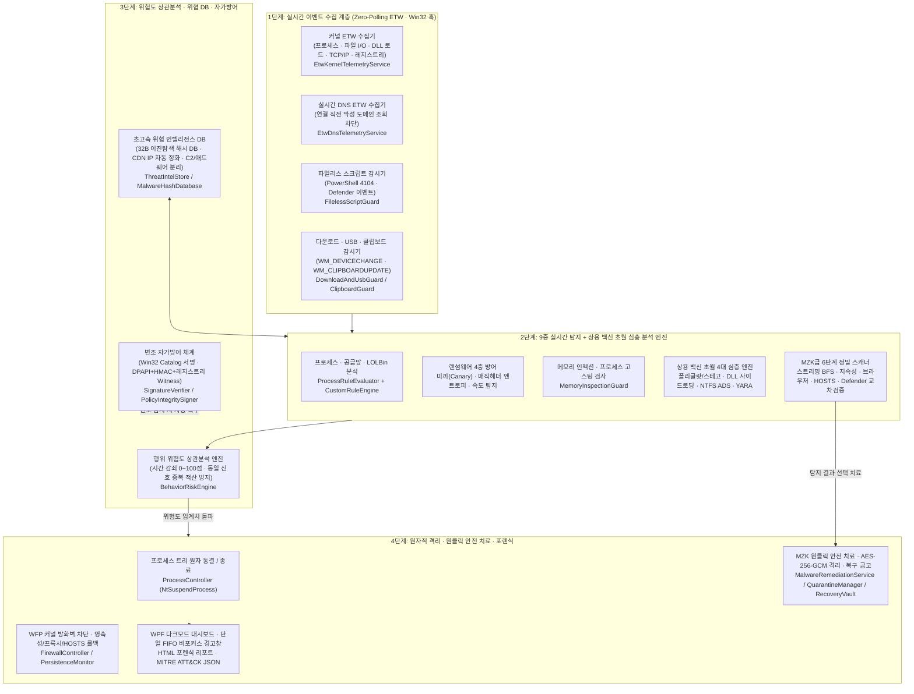

# 🛡️ AegisSentinel Enterprise

> **Windows 10/11용 통합 엔드포인트 탐지·대응(EDR) 및 MZK급 6단계 심층 백신 플랫폼**  
> 커널 ETW 실시간 감시 · 다단계 행위 상관분석 · O(1) 메모리 무제한 심층 파일 검사 · 상용 백신 초월 4대 탐지 엔진 · 원클릭 안전 치료 · MITRE ATT&CK 40개 기법 지원

[](https://dotnet.microsoft.com/)
[-0078D6?logo=windows)](https://www.microsoft.com/windows)
[](docs/MITRE_ATTACK_COVERAGE.md)
[](tests/AegisSentinel.Tests/RedTeamSimulationTests.cs)
[](LICENSE)

---

## 1. 프로젝트 개요 및 개발 배경

**AegisSentinel**은 현대 Windows 환경에서 발생하는 고도화된 보안 위협(랜섬웨어, 인포스틸러, 게임 런처·소프트웨어 공급망 DLL 사이드로딩, 파일리스 PowerShell 난독화, 한국 특화 HWP/LNK 스피어피싱, 확장자 위장·이미지 스테가노그래피·NTFS 숨김 스트림)을 **낮은 오탐률, 초저전력 상시 감시, 안전한 원자적 격리 및 복구**로 방어하기 위해 설계된 **.NET 10(C#) + Win32 네이티브 API 기반 통합 보안 솔루션**입니다.

기존 상용 백신과 단순 보안 도구가 가진 현실적인 한계를 해결하기 위해 다음 5가지 핵심 원칙으로 설계했습니다.

1. **폴링 없는 커널 ETW 실시간 수집**: 주기적으로 프로세스나 폴더를 훑는 대신 Windows 커널이 직접 이벤트를 밀어주는 `NT Kernel Logger`(프로세스·파일 I/O·DLL 로드·TCP/IP·레지스트리)와 `DNS-Client` ETW, Win32 클립보드/USB 훅을 사용해 평상시 CPU 점유율을 1% 미만으로 유지합니다.
2. **스마트 저마찰 상관분석 & 프로세스 트리 원자 동결**: 단순한 단일 의심 신호에 매번 팝업을 띄우지 않고 프로세스(PID) 단위로 행위 점수를 누적·감쇠 추적하다가, 공격 체인이 확정되는 순간 `NtSuspendProcess`로 악성 프로세스와 모든 자식 프로세스를 **동시에 일시정지(동결)**합니다.
3. **상용 백신 사각지대를 노리는 4대 심층 탐지 엔진**: 확장자만 보고 건너뛰거나 정상 서명된 호스트 실행파일을 무조건 신뢰하는 기존 백신의 약점을 보완하기 위해 **① 매직 헤더/폴리글랏/스테가노그래피 스니퍼, ② 공급망 DLL 사이드로딩 감지기, ③ NTFS 숨김 스트림(ADS) 스캐너, ④ 탈취 인증서 바이너리 YARA 정밀 검사**를 탑재했습니다.
4. **메모리 사용량 O(1) 무제한 전수 심층 검사**: 파일 개수 상한 없이 깊은 하위 폴더까지 100% 검사하면서도, `BlockingCollection(2048)` 기반 **생산자-소비자 스트리밍 너비우선탐색(BFS)**으로 메모리 사용량이 디스크 용량과 무관하게 일정 수준으로 유지됩니다.
5. **파괴 없는 원클릭 안전 치료 & 시스템 절대 보호**: 악성 파일은 영구 삭제 대신 **AES-256-GCM 암호화 격리소**로 이동하며, 변조된 브라우저 바로가기·HOSTS·프록시·NTFS 숨김 스트림은 원본 백업 후 악성 요소만 정밀 제거합니다. Windows 핵심 파일과 피해자 문서는 코드 레벨 가드레일로 절대 보호합니다.

---

## 2. 전체 시스템 아키텍처



> 상세 시퀀스 다이어그램, 스트리밍 BFS 파이프라인, 암호화 포맷, 배터리 최적화 설계는 [docs/ARCHITECTURE.md](docs/ARCHITECTURE.md)에 정리되어 있습니다.

---

## 3. 핵심 동작 로직 상세 설명

### 3.1 실시간 위험도 상관분석 및 원자적 동결 로직 (`BehaviorRiskEngine` → `SecurityOrchestrator`)
1. **이벤트 수신**: 프로세스 생성, 파일 쓰기, DLL 로드, DNS 질의, TCP 연결, 레지스트리 수정이 실시간으로 들어옵니다.
2. **서명 및 신뢰 검증 (`SignatureVerifier`)**: `WinVerifyTrust`의 임베디드 서명뿐 아니라, Windows 시스템 파일이 사용하는 **Win32 보안 카탈로그(`CryptCATAdmin*` + `WINTRUST_CATALOG_INFO`)**까지 실제로 검증해 경로 사칭을 막습니다.
3. **행위 점수 누적 및 시간 감쇠 (`BehaviorRiskEngine`)**:
   - 각 PID별로 서로 다른 공격 신호(예: `임시경로 미서명 실행` + `브라우저 자격증명 DB 접근` + `외부 HTTPS 통신`)를 시간 창 내에서 합산합니다.
   - 같은 종류의 신호가 반복 발생해도 자기 자신과 중복 적산되지 않도록(예: `40 + 40 + 40 = 100` 오동결 방지) 신호명 기준 최고점만 유지합니다.
   - 추가 악성 행위가 없으면 시간이 지나면서 점수가 자연 감쇠합니다.
4. **즉시 동결 및 단일 FIFO 알림 (`ProcessController` + `App.xaml.cs`)**:
   - 누적 위험도가 임계치(기본 80점)를 넘거나 랜섬웨어 미끼 변조·섀도 삭제 등 확정 공격이면 즉시 `NtSuspendProcess`로 부모·자식 프로세스 트리를 동결합니다.
   - 경고창(`ThreatPromptWindow`)은 화면 우측 하단에 **포커스를 빼앗지 않고(`ShowActivated="False"`) 1개씩 순차 FIFO 큐**로 표시되므로 작업 중 오입력이 발생하지 않으며, 알림창을 닫아도 동결된 고아 프로세스가 남지 않습니다.

### 3.2 O(1) 메모리 무제한 스트리밍 BFS 파일 검사 로직 (`MzkDeepScanner`)
- **기존 문제**: 전체 파일 경로를 `List<string>`에 한꺼번에 모으면 파일이 수십만~수백만 개인 PC에서 메모리가 급증하고, `maxFiles` 상한을 두면 깊은 폴더에 숨은 악성코드를 놓치게 됩니다.
- **해결 구조 (생산자-소비자 백프레셔 파이프라인)**:
  - **생산자(Producer) 스레드 1개**: 너비우선탐색(BFS) 큐로 최상위 위험 폴더(`Downloads`, `Desktop`, `Startup`, `Temp`, `Users\Public`, `AppData`, `ProgramData` 등)부터 최대 깊이 64단계까지 파일 개수 제한 없이(`int.MaxValue`) 순회하며, 용량이 **2,048개로 고정된 `BlockingCollection<string>`**에 파일 경로를 넣습니다.
  - **소비자(Consumer) 워커 2~4개**: 대기열에서 파일 경로를 꺼내 병렬로 해시·YARA·PE·스크립트·아카이브·폴리글랏·DLL 사이드로딩 검사를 수행하고 즉시 메모리에서 해제합니다.
  - 대기열이 2,048개로 차면 생산자가 자동으로 잠시 멈추고(Backpressure) 소비자가 처리하면 다시 채우는 방식이라 **모든 파일을 끝까지 검사하면서도 대기열 메모리는 약 0.5 MB 수준(전체 프로세스 RAM 안정 유지)**을 보장합니다.
  - 취소 또는 예외 발생 시 연결 토큰(`pipelineCts`)으로 생산자를 즉시 해제해 데드락이 절대 발생하지 않습니다.

### 3.3 상용 백신 사각지대를 잡는 4대 심층 탐지 엔진
1. **확장자 위장·폴리글랏·스테가노그래피 스니퍼 (`PolyglotAndMagicSniffer`)**:
   - `.png`, `.jpg`, `.pdf`, `.dat`, `.bin`, `.tmp`, `.txt`, 확장자 없는 파일까지 헤더(앞 4 KB)와 테일(뒤 256 KB)을 초고속 슬라이싱 검사합니다.
   - 이미지/문서 확장자 안에 숨겨진 진짜 Windows 실행파일(`MZ`/`PE\0\0`), PNG `IEND` 또는 JPEG `EOI(FF D9)` 뒤에 붙여 넣은 숨김 PE/ZIP/셸코드/스크립트, 비실행 데이터(`.dat`/`.bin`) 내부의 x64/x86 PEB 워킹 원시 셸코드, 악성 `/OpenAction` + `/Launch` 또는 `/JS` PDF를 탐지합니다.
2. **공급망 DLL 사이드로딩 감지기 (`DllSideloadingDetector`)**:
   - 정상 서명된 게임 런처·업데이터 옆에 `version.dll`, `winmm.dll`, `dbghelp.dll`, `winhttp.dll` 등 Windows 시스템 DLL 이름을 사칭한 미서명 프록시 DLL이 배치된 경우(디스크 정적 검사)와, 실제 실행 중인 서명 프로세스가 `C:\Windows\` 바깥의 미서명 시스템명 DLL을 로드한 경우(실시간 메모리 모듈 검사)를 모두 포착합니다.
3. **NTFS 숨김 스트림(ADS) 스캐너 (`NtfsAdsScanner`)**:
   - Windows 탐색기에 보이지 않는 `notes.txt:dropper.exe` 형태의 NTFS 대체 데이터 스트림(`:$DATA`)을 Win32 `FindFirstStreamW`/`FindNextStreamW`로 전수 열거하고, `:Zone.Identifier` 등 정상 메타데이터와 `::$EA`는 제외하면서 숨김 PE/스크립트를 잡아냅니다.
4. **탈취 인증서 바이너리 YARA 정밀 검사 (`SignaturePatternScanner`)**:
   - `TrustedMicrosoft`만 면제하고, 서드파티 서명 바이너리(12 MB 이하)도 셸코드 프롤로그·채굴기·랜섬웨어 섀도 와이퍼·LSASS 덤퍼·외부 웹훅 유출 스틸러 등 고신뢰 YARA 규칙으로 정밀 스캔합니다. (정상 비밀번호 관리자·브라우저 오탐 방지를 위해 서명 파일의 `BrowserStealer` 규칙은 Discord/Telegram 웹훅 유출 토큰 동반을 필수 조건으로 검증합니다.)

### 3.4 MZK급 6단계 정밀 검사 & 파괴 없는 원클릭 안전 치료 (`MalwareRemediationService`)
1. **1단계 (프로세스 · 명령줄 · 메모리)**: WMI 일괄 명령줄 조회, 리네임드 LOLBin, 실시간 DLL 사이드로딩, Process Ghosting(살아있는 프로세스 핸들 검증), 비-JIT Unbacked Private RWX 검사.
2. **2단계 (지속성 · 서비스 · 국내 PUP/그리드)**: `Run`/`RunOnce`, 시작 폴더, IFEO 디버거, Winlogon `Shell`/`Userinit`, WMI 영구 이벤트 소비자, 하위 폴더 포함 예약 작업(`<Command>` + `<Arguments>`), Windows 서비스(`ImagePath` + `ServiceDll`), 국내 그리드 딜리버리/애드웨어(`pup_rules.json`) 감사.
3. **3단계 (브라우저 하이재킹)**: Chrome/Edge/Whale/Brave 강제 정책 레지스트리, `Preferences` & `Secure Preferences` JSON(홈페이지·시작페이지·기본 검색엔진), 비공식 고권한 확장프로그램, 변조된 브라우저 `.lnk` 바로가기 검사.
4. **4단계 (시스템 · 네트워크 무결성)**: `HOSTS` DNS 하이재킹(사설 LAN IP 제외), WinInet 프록시/PAC 변조, Windows Defender 경로/확장자/프로세스 예외(GPO 포함) 악성 주입 검사.
5. **5단계 (무제한 BFS 파일 검사 + NTFS ADS 감사)**: 해시 DB + YARA + PE 정적 분석 + UTF-8/UTF-16LE 스크립트 분석 + ZIP 메모리 내 검사 + 홀수/짝수 오프셋 `.lnk` 분석 + 4대 심층 스니퍼 + 고위험 폴더 ADS 전수 감사.
6. **6단계 (Windows Defender 교차 검증)**: 최신 플랫폼 `MpCmdRun.exe`를 비파괴 모드(`-DisableRemediation`)로 병행 검증.
- **원클릭 안전 치료 원칙**:
  - 악성 파일은 **AES-256-GCM 인증 암호화 격리소(`AEGISQ2`)**로 이동(언제든 원본 복원 가능, 비트 변조 시 복원 거부).
  - 변조된 브라우저 바로가기(`.lnk`)는 아이콘을 지우지 않고 백업 후 악성 `Arguments`만 제거.
  - NTFS 숨김 스트림(ADS)은 스트림 백업 후 `DeleteFileW("파일:스트림")`으로 **원본 문서를 100% 보존**하고 숨김 페이로드만 제거.
  - Chromium 브라우저가 실행 중일 때는 설정 덮어쓰기 경합을 막기 위해 종료 안내 후 안전 복구하며, `Secure Preferences`의 `protection.macs`/`super_mac`도 함께 정리.
  - 프록시 복구 직후 WinInet `InternetSetOption`을 호출해 재부팅 없이 즉시 반영.

---

## 4. 9계층 실시간 방어 + 심층 백신 매트릭스

| 계층 | 방어 영역 | 핵심 모듈 | 주요 탐지·대응 기술 (MITRE ATT&CK) |
| :---: | :--- | :--- | :--- |
| **L1** | 프로세스 · 공급망 · LOLBin | `ProcessRuleEvaluator`, `ProcessTreeTracker` | 다단계 런처 계보, 리네임드 LOLBin(`OriginalFilename` 캐시), 가짜 `svchost`, UAC 우회 (`T1195.002`, `T1036.003`, `T1548.002`) |
| **L2** | Detection-as-Code 커스텀 룰 | `CustomRuleEngine` (`rules.json`) | Sigma 스타일 JSON 룰 핫리로드, .NET `NonBacktracking` 선형 시간 ReDoS 방어, 기본 SOC 룰 6종 (`T1140`, `T1127.001`, `T1003.003`) |
| **L3** | 파일리스 · 난독화 스크립트 | `FilelessScriptGuard`, `ScriptFileAnalyzer` | PowerShell 4104 백틱·문자열결합·Base64·`[char]` 역난독화, `.ps1`/`.bat`/`.vbs`/`.js`/`.hta`/`.wsf`/`.sct` 정적 검사 (`T1059.001`, `T1027`) |
| **L4** | 랜섬웨어 4중 방어 · 복구 금고 | `RansomwareDetector`, `CanaryManager`, `EntropyAnalyzer`, `RecoveryVault` | 미끼 파일, 매직 헤더+섀넌 엔트로피(암호화 Office OLE2 오탐 방지), 섀도 삭제 차단, SHA-256 검증 1클릭 복원 (`T1486`, `T1490`) |
| **L5** | 메모리 인젝션 · 고스팅 | `MemoryInspectionGuard` | `VirtualQueryEx` Unbacked Private RWX, Process Ghosting 생존 핸들 검증, .NET/Unity/CEF JIT 필터 (`T1055`, `T1055.012`) |
| **L6** | 자격증명 · 브라우저 · DLL 보호 | `CredentialAndDllGuard`, `DllSideloadingDetector` | Chrome/Edge 원격디버깅 ABE 우회 차단, 쿠키/`.ssh`/`.aws`/가상자산 지갑 보호, 정적·실시간 DLL 사이드로딩 (`T1539`, `T1555.003`, `T1574.001`) |
| **L7** | 네트워크 · DNS · 위협 인텔 | `EtwDnsTelemetryService`, `NetworkGuardMonitor`, `ThreatIntelStore` | 연결 직전 ETW DNS C2 차단, Feodo/IPsum/URLhaus/StevenBlack 동기화(C2 vs 애드웨어 분리 & CDN IP 정화), WFP 커널 방화벽 (`T1071`, `T1041`) |
| **L8** | 아카이브 · 컨테이너 · 클립보드 | `ZipArchiveAnalyzer`, `LnkAndContainerAnalyzer`, `ClipboardGuard` | ZIP 메모리 내 스트리밍 검사(최대 2,500 엔트리 + EICAR/YARA), 홀수/짝수 오프셋 `.lnk` 파싱, ClickFix 클립보드 감시 (`T1204.002`, `T1115`) |
| **L9** | 영속성 · OS 무결성 · 자가방어 | `PersistenceMonitor`, `SystemIntegrityGuard`, `PolicyIntegritySigner`, `WindowsSecurityHardening` | 7종 자동실행/HOSTS/프록시/Defender 예외 감시·롤백, DPAPI+HMAC+레지스트리 Witness 자가복구, Defender CFA/5대 ASR 연동 (`T1547`, `T1562.001`) |
| **AV+** | **MZK 6단계 + 4대 초월 엔진** | `MzkDeepScanner`, `PolyglotAndMagicSniffer`, `NtfsAdsScanner`, `MalwareRemediationService` | O(1) 메모리 무제한 BFS 전수 검사, 폴리글랏/스테고/원시 셸코드/ADS 탐지, AES-256-GCM 격리 및 비파괴 원클릭 치료 |

---

## 5. 실측 성능 벤치마크 및 검증 지표

실제 Windows 11 x64 환경(`Release`, .NET 10)에서 자동화 벤치마크 및 전체 회귀 테스트로 검증한 결과입니다.

| 엔진 모듈 | 측정 항목 | 평균 지연 시간 | 처리량 | 핵심 최적화 기법 |
| :--- | :--- | :---: | :---: | :--- |
| **`ProcessRuleEvaluator`** | 프로세스 평가 + 6개 커스텀 룰 + PE 원본파일명 | **`38.98 µs/op`** | **`25,654 ops/sec`** | `(LastWriteTicks, Length)` 512개 검증 캐시 (기존 251 µs 대비 **6.4배 단축**) |
| **`ScriptFileAnalyzer`** | PowerShell 스크립트 정적·난독화 검사 | **`3.36 µs/op`** | **`297,212 ops/sec`** | 컴파일드 정규식 + 타임아웃 ReDoS 방어 |
| **`EntropyAnalyzer`** | 64 KB 버퍼 섀넌 엔트로피 + 매직 헤더 검증 | **`27.78 µs/op`** | **`36,002 ops/sec`** | Zero-copy `ReadOnlySpan<byte>` 스택 연산 |
| **`ThreatIntelStore`** | 악성 도메인 `O(라벨수)` 접미사 조회 | **`0.92 µs/op`** | **`1,087,000 ops/sec`** | 해시셋 접미사 분할 조회 (선형 스캔 제거) |
| **`MalwareHashDatabase`** | 대규모 악성코드 SHA-256 32B 바이너리 `O(log N)` 조회 | **`~0.73 µs/op`** | **`1,360,000+ ops/sec`** | 정렬된 32바이트 바이너리 인덱스 · Zero-Allocation |

### 최종 검증 결과
- **Release 클린 빌드 (`-warnaserror --no-incremental`)**: **경고 0개 · 오류 0개**
- **자동화 테스트 & 레드팀 시뮬레이션**: **38 / 38 전체 통과** (실 PC 무제한 MZK 심층 스캔, 실 PC 실행 앱 오동결 0건, 자체 바이너리 자가 오탐 0건 포함)
- **Windows Defender 정밀 스캔 (`MpCmdRun.exe`)**: **`found no threats`** (오탐 0건)
- **테스트 임시 폴더 누수**: **`0건`**

---

## 6. 빌드 및 실행 방법 (Quickstart)

### 사전 요구 사항
- Windows 10 / 11 (x64)
- [.NET 10 SDK](https://dotnet.microsoft.com/download/dotnet/10.0)
- 실시간 커널 ETW 텔레메트리 및 WFP 방화벽 제어를 위해 **관리자 권한(Administrator)** 필요 (`app.manifest`에 선언됨)

### 빌드 · 테스트 · 실행 명령

```powershell
# 1. 클린 Release 빌드 (모든 경고를 오류로 엄격 검사)
dotnet build AegisSentinel.slnx -c Release -warnaserror

# 2. 전체 38개 단위 · 레드팀 시뮬레이션 · 실환경 감사 테스트 실행
dotnet test tests/AegisSentinel.Tests/AegisSentinel.Tests.csproj -c Release --no-build --verbosity normal

# 3. WPF 통합 보안 센터 실행
.\src\AegisSentinel.App\bin\Release\net10.0-windows\AegisSentinel.App.exe
```

> 모든 자동화 테스트는 격리된 `%TEMP%\Aegis*` 임시 디렉터리에서만 실행되며 종료 시 100% 정리됩니다. 사용자의 실제 파일이나 시스템 설정은 건드리지 않습니다.

---

## 7. 프로젝트 디렉터리 구조

```text
AegisSentinel/
├── .github/workflows/ci.yml        # GitHub Actions 자동 빌드(-warnaserror) 및 테스트 CI
├── docs/
│   ├── ARCHITECTURE.md             # 상세 아키텍처, 스트리밍 BFS, 암호화 격리, 최적화 설계서
│   ├── THREAT_MODEL.md             # 보호 자산, 신뢰 경계, 공격자 모델, Ring-3 한계 및 커널 보완
│   ├── MITRE_ATTACK_COVERAGE.md    # 40개 MITRE ATT&CK 기법 전체 한국어 매핑표 & Navigator 안내
│   └── INTERVIEW_GUIDE.md          # 정보보안 기술 심층 Q&A 12선 (실전 트러블슈팅 사례 포함)
├── src/
│   ├── AegisSentinel.Core/         # 순수 탐지 · 대응 · 심층 백신 · 포렌식 코어 (.NET 10)
│   │   ├── Engine/                 # 29개 핵심 탐지/분석/상관/심층스캔/치료 엔진
│   │   ├── Services/               # Win32 Catalog 서명, 해시 DB, AES-GCM 격리소, 복구금고, WFP, 자가방어
│   │   ├── Models/                 # 보안 이벤트, 정책 모델, MZK 스캔 모델, MITRE 40기법 카탈로그
│   │   └── Native/                 # Win32 P/Invoke (NtSuspendProcess, WinTrust/Catalog, RestartManager 등)
│   └── AegisSentinel.App/          # WPF 다크모드 통합 대시보드 · 트레이 상주 · 단일 FIFO 경고창
└── tests/
    └── AegisSentinel.Tests/        # 38개 단위 · 레드팀 · MZK · 4대 초월엔진 · 코드리뷰 회귀 테스트
```

---

## 8. 정직한 보안 경계 (Ring-3 vs Ring-0)

AegisSentinel은 **유저모드(Ring-3) + 관리자 권한**으로 동작하는 보안 솔루션입니다. 커널 드라이버(Ring-0)가 없는 구조에서 발생할 수 있는 한계(BYOVD 커널 루트킷, 동기 I/O 차단 레이스 윈도우, SYSTEM 탈취 시 PPL 부재)를 [docs/THREAT_MODEL.md](docs/THREAT_MODEL.md)에 투명하게 정리했으며, 이를 **Windows Defender 커널 폴더 보호(CFA) · 5대 ASR 규칙 · HVCI(메모리 무결성) · DPAPI/HMAC/레지스트리 Witness 자가방어**와 결합하여 실용적인 심층 방어(Defense-in-Depth)를 구현했습니다.

---

## 라이선스

이 프로젝트는 [MIT License](LICENSE) 하에 배포됩니다. 방어적 보안 연구, 학습 및 엔드포인트 보호 목적으로 사용해 주세요.
