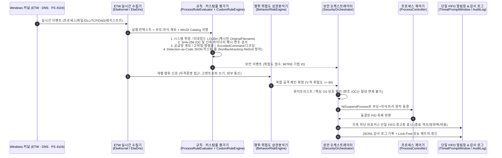
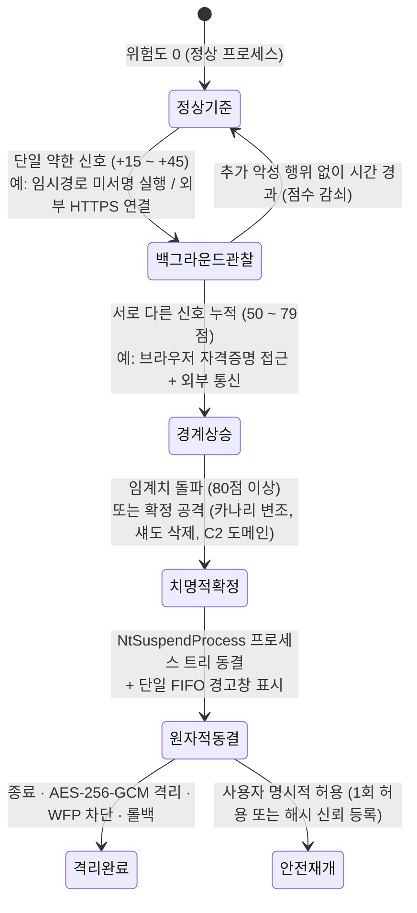
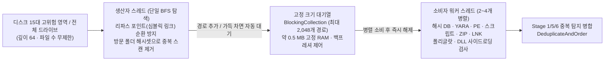

# AegisSentinel Enterprise — 상세 아키텍처 및 내부 로직 설계서

이 문서는 **AegisSentinel**의 실시간 커널 ETW 수집 파이프라인, 다단계 행위 상관분석(`BehaviorRiskEngine`), O(1) 메모리 무제한 스트리밍 BFS 파일 스캐너(`MzkDeepScanner`), 상용 백신 초월 4대 탐지 엔진, AES-256-GCM 암호화 격리소, 그리고 노트북 저전력 최적화 구조까지 내부 동작 원리를 한국어로 상세히 설명합니다.

---

## 1. 실시간 텔레메트리 및 탐지 파이프라인

AegisSentinel은 주기적인 폴링(`Process.GetProcesses()` 반복 호출 등) 대신 Windows 커널이 직접 발행하는 **ETW(Event Tracing for Windows)** 스트림과 Win32 이벤트 훅을 중심으로 동작합니다.

---

## 2. 다단계 행위 상관분석 로직 (`BehaviorRiskEngine`)

단일 행위만으로는 정상 앱과 악성코드를 구분하기 어렵습니다(예: 개발 도구가 443 포트로 HTTPS 통신을 하거나, 압축 프로그램이 파일을 빠르게 쓰는 경우). `BehaviorRiskEngine`은 PID 단위로 **시간 감쇠(Temporal Decay) 기반 누적 위험도(0~100점)**를 계산합니다.

### 오탐 방지 핵심 로직
- **동일 신호 중복 적산 금지**: 같은 신호(예: `UnsignedDropperNetwork` 또는 DNS+TCP `HttpsExfilAbuseChannel`)가 여러 번 발생하더라도 점수를 계속 더하지 않고 해당 신호의 최고점 1회만 반영해 반복 접속으로 인한 오동결을 원천 차단합니다.
- **신호명 정규화**: 점수 표기(`SignalName(+55)` 또는 `SignalName:세부정보(+55)`)에서 `:` 또는 `(` 앞부분을 주 신호명으로 정확히 추출해 서로 다른 IP/파일로 인한 중복 적산을 방지합니다.
- **대표 공격 체인 상관 예시**:
  - **인포스틸러 체인**: `임시경로 미서명 실행(+25)` + `브라우저 쿠키/비밀번호 접근(+60)` + `외부 HTTPS 유출(+35)` → **100점 즉시 동결**
  - **저속 랜섬웨어 체인**: `복구금고 스냅샷 확보` → `문서 매직헤더 파괴 + 고엔트로피 암호화(+45)` + `고속 변조/삭제(+40)` → **85점 즉시 동결 + 1클릭 원본 복원**

---

## 3. O(1) 메모리 무제한 스트리밍 BFS 파일 스캐너 (`MzkDeepScanner`)

대용량 PC 디스크 전체나 MZK 15대 고위험 영역을 **깊이 100%(최대 64단계), 파일 수 무제한(`int.MaxValue`)**으로 검사하면서도 RAM 사용량이 폭주하지 않도록 **유계 생산자-소비자(Bounded Producer-Consumer) 스트리밍 파이프라인**을 구현했습니다.

- **데드락 방지 설계**: `Parallel.ForEach` 소비자가 예외 또는 취소로 조기 종료하더라도 `finally` 블록에서 연결된 `pipelineCts.Cancel()`을 호출해 대기열에 막혀 있던 생산자 스레드를 즉시 깨워 종료합니다.
- **Stage 1/5/6 결과 통합**: 1단계(실행 프로세스), 5단계(디스크 파일), 6단계(Defender 교차 검증)에서 같은 악성 파일이 중복 탐지될 경우 하나의 항목으로 병합하고 실행 중인 `ProcessId` 정보를 보존해 종료+격리가 한 번에 수행되도록 합니다.

---

## 4. 상용 백신 초월 4대 심층 탐지 엔진 로직

| 엔진 | 핵심 검사 방식 | 오탐 방지 가드레일 |
| :--- | :--- | :--- |
| **`PolyglotAndMagicSniffer`** (확장자 위장 · 스테고 · 셸코드 · PDF) | • 앞 4 KB 헤더로 비실행 확장자(`.png`/`.jpg`/`.pdf`/`.txt`/`.dat`) 내 `MZ`/`PE\0\0` 위장 탐지 • 뒤 256 KB 테일에서 PNG `IEND` / JPEG `EOI` 이후 숨김 PE·ZIP·셸코드·스크립트 추출 • `.dat`/`.bin`/`.tmp` 원시 x64/x86 PEB 워킹 셸코드 시그니처 매칭 • PDF 정규식 경계 매칭(`/OpenAction`, `/Launch`, `/JS`) | • PNG/JPEG 마지막 16바이트 정상 EOF 시 0.05ms 이내 즉시 통과 • PNG `LastIndexOf` 사용으로 메타데이터 썸네일 오탐 차단 • 브라우저/컴파일러 캐시 및 서명된 벤더 `.bin`, 깨끗한 `\Temp\*.tmp` 인스톨러 제외 |
| **`DllSideloadingDetector`** (공급망 DLL 사이드로딩) | • **정적 검사**: `C:\Windows\` 외부에서 37종 시스템명 프록시 DLL(`version.dll`, `winmm.dll`, `dbghelp.dll` 등)이 미서명 PE 상태로 서명된 `.exe` 옆에 배치된 경우 탐지 • **실시간 메모리 검사**: 실행 중인 서명 프로세스의 로드 모듈 중 `C:\Windows\` 외부 미서명 시스템명 DLL 탐지 | • 실제 `MZ`/`PE` 유효 헤더 검증 + `ProcessModule` 즉시 `Dispose` • Steam/GOG 게임 폴더 내 비-MotW 모드 로더는 자동 치료 체크 해제(`ManualReview` 안내) |
| **`NtfsAdsScanner`** (숨김 NTFS 대체 스트림) | • Win32 `FindFirstStreamW`/`FindNextStreamW`로 파일에 숨겨진 `:$DATA` 스트림 전수 열거 • 숨김 스트림 내부의 `MZ`/`PE` 헤더 및 위험 확장자(`.exe`/`.ps1`/`.vbs` 등) 검사 | • `:Zone.Identifier`, `:SmartScreen`, `:com.dropbox`, `:com.apple.*`, 비-`$DATA` 속성(`::$EA`) 제외 • 치료 시 호스트 원본 파일은 100% 보존하고 스트림만 `DeleteFileW`로 정밀 삭제 |
| **`SignaturePatternScanner`** (YARA-X 스타일 · 탈취 인증서 대응) | • 파일 크기 → 매직 바이트 → 컴파일된 헥스 와일드카드 → 다중 토큰 순서의 고속 단락 평가 • 최대 12 MB 전체 읽기 + OOXML(`.docm`/`.xlsm`) `vbaProject.bin` 메모리 내 압축 해제 검사 • `TrustedMicrosoft`만 면제하고 서드파티 서명 바이너리도 고신뢰 악성 룰 검사 | • 서명된 정상 비밀번호 관리자/브라우저 보호를 위해 서명 바이너리의 `BrowserStealer` 규칙은 Discord/Telegram 웹훅 토큰 필수 요구 • 자사 DLL 자가 오탐 방지를 위해 리터럴 토큰 분할(`string.Concat`) 적용 |

---

## 5. 암호화 격리 · 자가방어 · 안전 가드레일

1. **AES-256-GCM 인증 암호화 격리소 (`QuarantineManager`, 포맷 `AEGISQ2`)**:
   - 격리 대상 파일을 DPAPI로 보호된 기기 전용 256비트 키와 파일별 랜덤 96비트 Nonce로 암호화하고 128비트 인증 태그(GCM Tag)를 저장합니다.
   - 복원 시 단 1비트라도 변조된 경우 GCM 인증 실패로 복원을 거부합니다.
   - 리파스 포인트(심볼릭 링크/정션) 상위 경로 검사로 격리·삭제 악용 공격을 차단하며, 사용 중 잠긴 파일은 `MoveFileEx(MOVEFILE_DELAY_UNTIL_REBOOT)`로 재부팅 삭제를 예약하고 복원 시 예약 취소까지 처리합니다.
2. **Win32 카탈로그 서명 검증 (`SignatureVerifier`)**:
   - 일반 `WinVerifyTrust(WTD_CHOICE_FILE)` 실패 시(`TRUST_E_NOSIGNATURE`) 경로만 보고 신뢰하지 않고, `CryptCATAdminCalcHashFromFileHandle2` + `CryptCATAdminEnumCatalogFromHash` + `WTD_CHOICE_CATALOG`로 Windows OS 카탈로그 서명을 암호학적으로 검증합니다.
3. **DPAPI + HMAC-SHA256 + 레지스트리 Witness 자가방어 (`PolicyIntegritySigner`)**:
   - `policy.json`, `rules.json`, `pup_rules.json`, 복구 금고 `index.json`에 모두 HMAC-SHA256 서명을 적용합니다.
   - 공격자가 `.hmac` 파일과 `.aegis_seal.key`를 함께 삭제해 "초기 마이그레이션"으로 속이려 해도 `HKCU\Software\AegisSentinel\IntegrityWitness` 흔적을 대조해 즉시 변조(`SelfDefenseTamper`)로 탐지하고 안전 기본값으로 자동 복구합니다.
4. **4중 시스템·문서 안전 가드레일**:
   - **핵심 OS 보호**: `System32`, `SysWOW64`, `WinSxS`, `WindowsApps\Microsoft.*`, `Windows Defender`, `AegisSentinel` 설치 폴더는 동결·종료·격리·방화벽 차단에서 무조건 보호됩니다. (단, 악성코드가 자주 악용하는 `C:\Windows\Temp`, `Windows\Tasks`, `Windows\Debug`는 예외적으로 탐지·격리 가능!)
   - **피해자 문서 보호**: 랜섬웨어 대응 시 `TargetPath`(사용자 원본 `.docx`/`.hwp`)는 절대 격리하지 않고 공격자 `ProcessPath`만 격리합니다.
   - **LOLBin 화이트리스트 오염 방지**: `powershell.exe`, `cmd.exe`, 브라우저 등은 사용자가 허용해도 영구 화이트리스트에 등록되지 않도록 `GuardPolicy.SanitizeAndValidate()`가 자동 필터링합니다.
   - **비파괴 치료**: 브라우저 바로가기(`.lnk`)는 아이콘을 유지한 채 악성 `Arguments`만 제거하고, HOSTS/Preferences/확장/ADS는 모두 `RemediationBackups`에 백업 후 정밀 복구합니다.

---

## 6. 초고속 위협 인텔리전스 DB & 배터리 최적화

### 6.1 위협 DB 설계 (`ThreatIntelStore` & `MalwareHashDatabase`)
- **32바이트 정렬 바이너리 해시 인덱스**: 10~16만 개 이상의 악성 SHA-256 해시를 64자 문자열 대신 32바이트 원시 배열로 정렬 저장해 디스크/RAM 약 3~5 MB만 사용하며, `Span` 기반 이진 탐색(`O(log N)`)으로 조회당 **약 0.7 µs** 만에 판별합니다.
- **0바이트/공백/빈 ZIP 오염 차단**: 공개 피드에 실수로 포함될 수 있는 빈 파일(`e3b0c442...`) 등 무해 해시는 `NeverBlockTrivialSha256`으로 자동 차단합니다.
- **C2 vs 애드웨어 도메인 엄격 분리 & 공용 CDN IP 자동 정화**:
  - 실시간 ETW DNS 동결은 **사용자 IOC + 확정 악성 C2(URLhaus)**만 사용하고, 광고/텔레메트리 목록(StevenBlack)은 브라우저 하이재킹 정리 전용으로 분리했습니다.
  - Cloudflare, Microsoft Azure/FrontDoor, Akamai, Google, GitHub 등 공용 인프라 IP는 피드 동기화 및 로컬 `intel.json` 로드 시 자동 스크러빙하여 정상 앱 오동결을 0으로 유지합니다.

### 6.2 노트북 배터리·성능 최적화
| 영역 | 일반 보안 도구 방식 | AegisSentinel 최적화 방식 | 실측 효과 |
| :--- | :--- | :--- | :--- |
| **프로세스·파일·네트워크** | 1~3초 주기 폴링 | 커널 ETW 푸시 스트림 + 배터리 시 보조 타이머 2배 완화 | 유휴 CPU **< 1%** |
| **PE 원본파일명 조회** | 매 실행마다 디스크 `FileVersionInfo` | `(LastWriteTicks, Length)` 512개 변조 감지 캐시 | **251 µs → 39 µs (6.4배)** |
| **클립보드 · USB 감시** | 주기적 타이머 폴링 | Win32 `WM_CLIPBOARDUPDATE` · `WM_DEVICECHANGE` 훅 | 유휴 CPU 깨움 **0회** |
| **커스텀 룰 평가** | 전역 `lock` + 일반 정규식 | `volatile` 스냅샷 스왑(Lock-Free) + `.NET NonBacktracking` | 스레드 경합 **0**, ReDoS 원천 차단 |
| **WPF UI 응답성** | UI 스레드 동기 조회 | 네트워크/지속성/격리/초기 로드 전부 `Task.Run` 비동기 오프로딩 | UI 프리징 **0** |
