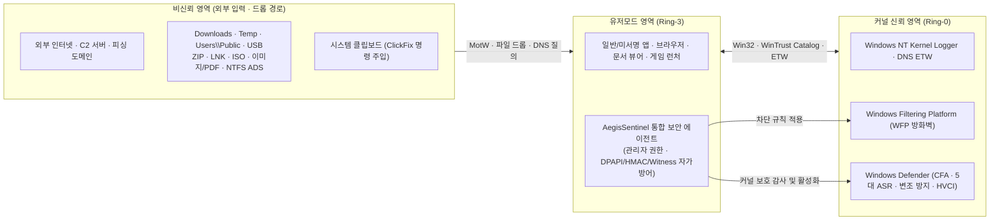

# AegisSentinel Enterprise — 위협 모델 및 보안 경계 (Threat Model)

실무 보안 엔지니어링에서 가장 중요한 것은 **"내가 만든 보안 시스템이 무엇을 확실히 막을 수 있고, 구조적으로 무엇을 막기 어려운지"**를 정직하고 명확하게 정의하는 것입니다. 이 문서는 AegisSentinel의 보호 자산, 신뢰 경계, 가정된 공격자 프로파일, 자가방어 메커니즘, 그리고 유저모드(Ring-3) EDR의 한계와 커널 보완 전략을 정리합니다.

---

## 1. 보호 자산 (Protected Assets)

| 자산 ID | 분류 | 보호 대상 | 침해 시 피해 |
| :---: | :--- | :--- | :--- |
| **A1** | 사용자 핵심 문서 | 문서(`.docx`, `.hwp`, `.hwpx`, `.pdf`, `.xlsx`), 소스 코드, 개인 파일 | 랜섬웨어 암호화 및 데이터 영구 손실 |
| **A2** | 자격증명 · 세션 · 지갑 | 브라우저 쿠키/비밀번호 DB(Chrome/Edge/Whale/Firefox), SSH 키, `.aws`/`.azure`/`.kube`, 가상자산 지갑, LSASS/SAM | 계정 탈취, 클라우드/금융 2차 피해 |
| **A3** | OS 무결성 · 네트워크 | Windows Defender 설정/예외, HOSTS 파일, WinInet 프록시/PAC, Run/IFEO/Winlogon/서비스/예약작업/WMI | 백신 무력화, 중간자(MITM) 가로채기, 영구 백도어 |
| **A4** | 보안 에이전트 자체 무결성 | `policy.json`, `rules.json`, `pup_rules.json`, 격리소(`Quarantine`), 복구 금고(`RecoveryVault`), 감사 로그 | 공격자에 의한 탐지 끄기, 화이트리스트 오염, 흔적 삭제 |

---

## 2. 신뢰 경계 (Trust Boundaries)

- **경계 1 (외부/다운로드 → 로컬 실행)**: `Downloads`, `Temp`, `Users\Public`, 이동식 USB, Mark-of-the-Web(MotW)이 붙은 파일, 압축 아카이브(`.zip`) 및 숨김 스트림(ADS)은 모두 비신뢰 입력으로 취급해 실행 전 정적·내용 분석을 수행합니다.
- **경계 2 (정상 서명 앱 → 비정상 행위)**: 공식 서명된 게임 런처·브라우저·문서 뷰어라 하더라도 외부 미서명 시스템명 DLL을 로드(사이드로딩)하거나, 셸(`cmd`/`powershell`/`mshta`) 자식 프로세스를 띄우거나, 원격 디버깅 플래그로 기동되면 즉시 신뢰 경계 침범으로 판단합니다.
- **경계 3 (디스크 설정 파일 → EDR 엔진)**: 디스크에 저장된 정책·커스텀 룰·PUP 룰·복구 금고 인덱스는 공격자가 변조하거나 서명 파일을 지울 수 있으므로 `PolicyIntegritySigner`가 **DPAPI + HMAC-SHA256 + 레지스트리 Witness**로 무결성을 강제 검증합니다.

---

## 3. 가정된 공격자 프로파일 및 방어 매핑

| 공격자 유형 | 대표 공격 기법 (TTPs) | AegisSentinel 대응 계층 |
| :--- | :--- | :--- |
| **1. 현대 랜섬웨어** | `vssadmin`/`wbadmin`/`bcdedit` 섀도 복사본 삭제, 대량/저속 파일 암호화 | `ProcessRuleEvaluator`(T1490 즉시 동결) + `CanaryManager` + `EntropyAnalyzer`(매직헤더+섀넌) + `RecoveryVault` 1클릭 복원 + Defender CFA |
| **2. 인포스틸러** | 브라우저 쿠키/DB 직접 읽기, Chrome ABE 원격디버깅 우회, SSH/클라우드/지갑 탈취 후 HTTPS 443·Telegram/Discord 유출 | `CredentialAndDllGuard` + `ProcessRuleEvaluator`(T1539) + `BehaviorRiskEngine`(자격증명+외부통신 상관) + `NetworkGuardMonitor` + WFP 방화벽 |
| **3. 한국 특화 APT · 공급망 공격** | HWP/수식편집기 악성 문서, `.hwp.lnk`/홀수 오프셋 LNK, **니케(NIKKE)형 게임 런처 DLL 사이드로딩**, 탈취 인증서 서명 악성코드 | `DllSideloadingDetector`(정적+실시간 모듈) + `LnkAndContainerAnalyzer`(짝수/홀수 오프셋) + `ProcessTreeTracker`(다단계 계보) + `SignaturePatternScanner` |
| **4. 상용 백신 회피(은닉 페이로드)** | `.png`/`.jpg`/`.pdf` 위장 PE, 이미지 `IEND`/`EOI` 뒤 폴리글랏 페이로드, `.dat`/`.bin` 원시 셸코드, NTFS 숨김 스트림(ADS) | `PolyglotAndMagicSniffer` + `NtfsAdsScanner` + `MalwareRemediationService`(원본 보존 ADS 정밀 제거) |
| **5. 방어 회피 · LOLBin · 영속성** | `certutil`/`msbuild`/`installutil`, 가짜 `svchost`, 리네임드 PowerShell, 예약 작업 `<Arguments>` 악용, Defender 예외/HOSTS/프록시 변조 | `CustomRuleEngine`(`AEGIS-001`~`006`) + `SignatureVerifier`(Win32 Catalog) + `PersistenceMonitor` + `SystemIntegrityGuard` + `MzkDeepScanner` |

---

## 4. 자가방어 메커니즘 (Self-Defense)

1. **DPAPI + HMAC-SHA256 + 레지스트리 Witness (`PolicyIntegritySigner`)**:
   - 기기 종속 DPAPI 키로 `policy.json`, `rules.json`, `pup_rules.json`, `RecoveryVault` 인덱스에 HMAC 서명을 부여합니다.
   - 공격자가 정책을 수정하거나 `.hmac` + `.aegis_seal.key`를 통째로 삭제해도 레지스트리 Witness를 통해 변조를 즉시 적발하고 안전 기본값으로 자동 복구(`SelfDefenseTamper`, `T1562.001`)합니다.
2. **변조 바이너리의 화이트리스트 우회 차단**:
   - 신뢰 등록된 실행파일은 경로가 아니라 **SHA-256 해시 핀(`TrustedBinaryHashes`)**으로 감시하며, 해시 불일치(`BinaryTampering`), `Masquerading`, `StaticMalware`, 위협 인텔리전스 IOC 적중은 화이트리스트로 절대 무시되지 않습니다.
3. **ReDoS(정규식 서비스 거부) 원천 차단**:
   - `CustomRuleEngine`과 `BrowserAndPupCleaner`는 .NET 10 `RegexOptions.NonBacktracking`(선형 시간 $O(n)$ 보장) + 중첩 수량자 사전 차단 + 200ms 타임아웃을 적용합니다.
4. **자가 오탐 및 시스템 자해 방지**:
   - `QuarantineManager.IsProtectedSystemOrSelfPath`와 `ProcessController.IsCriticalProtectedProcess`로 Windows 핵심 파일·UWP 시스템 앱·Defender·자사 경로를 보호하며, 격리·복원·치료 전 심볼릭 링크(Reparse Point) 검증을 수행합니다.

---

## 5. 유저모드(Ring-3)의 솔직한 한계 및 커널(Ring-0) 보완 전략

상용 대형 EDR은 Microsoft WHQL/EV 서명을 받은 **커널 미니필터 드라이버(Ring-0)**와 **ELAM / PPL(Protected Process Light)**을 사용합니다. AegisSentinel은 유저모드 관리자 권한 기반이므로 다음 4가지 구조적 한계를 투명하게 인지하고 보완책을 결합했습니다.

| 한계 영역 | 공격 시나리오 | AegisSentinel의 보완 및 완화 전략 |
| :--- | :--- | :--- |
| **1. 커널 드라이버 / BYOVD** | 취약한 서명 드라이버를 로드해 커널 콜백 무력화 | `ProcessRuleEvaluator`가 `sc create type= kernel` 명령을 즉시 차단하고, `WindowsSecurityHardening`이 **HVCI(메모리 무결성)** 및 취약 드라이버 차단 정책을 점검합니다. |
| **2. 비동기 ETW 레이스 윈도우** | 커널 미니필터의 동기 I/O 차단(`IRP_MJ_CREATE`) 대비 수 밀리초의 사후 지연 존재 | 탐지 즉시 `NtSuspendProcess`로 프로세스 트리를 동결하고, 사전 동기 차단은 커널 내장 **Defender Controlled Folder Access(CFA)** 및 **5대 ASR 규칙**에 위임하며, 초기 피해 파일은 `RecoveryVault`로 1클릭 복원합니다. |
| **3. SYSTEM/관리자 권한 탈취 후 종료** | 이미 최고 권한을 쥔 공격자가 에이전트를 강제 종료하거나 ETW 세션을 중지 | Microsoft ELAM 서명 없이는 PPL을 직접 적용할 수 없으므로, **Defender Tamper Protection** 활성화를 점검하고 정책/룰/감사로그의 사후 변조 흔적을 암호학적으로 보전합니다. |
| **4. 유저모드 API 언후킹 / Direct Syscall** | 악성코드가 `ntdll.dll`을 언후킹해 유저모드 훅을 우회 | AegisSentinel은 대상 프로세스에 DLL을 주입해 후킹하지 않고 **커널이 직접 발행하는 ETW 텔레메트리**를 구독하므로, 유저모드 언후킹이나 Direct Syscall로 프로세스·파일·DLL·TCP 이벤트를 숨길 수 없습니다. |
